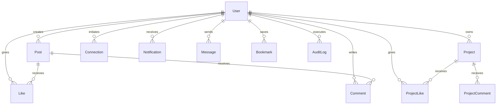

# DevPulse | Independent Developer Community & Project Showcase Platform

> **Live Production-Ready Platform**: DevPulse is a full-featured independent developer community platform where programmers can build their technical identity, showcase software projects, share coding reels, connect with peers, and discover cutting-edge open source work.

---

## 📑 Table of Contents

- [1. Platform Overview & Identity](#1-platform-overview--identity)
- [2. System Architecture & Tech Stack](#2-system-architecture--tech-stack)
- [3. Complete Feature Breakdown](#3-complete-feature-breakdown)
  - [3.1 Modern Professional Authentication & Registration](#31-modern-professional-authentication--registration)
  - [3.2 Community Feed (Social Platform Experience)](#32-community-feed-social-platform-experience)
  - [3.3 YouTube-Style Single Like System](#33-youtube-style-single-like-system)
  - [3.4 Project Submission & Showcase System](#34-project-submission--showcase-system)
  - [3.5 DevReels: Vertical Project Video Feed](#35-devreels-vertical-project-video-feed)
  - [3.6 Developer Discovery & Advanced Search](#36-developer-discovery--advanced-search)
  - [3.7 Connections & Friends Network](#37-connections--friends-network)
  - [3.8 In-App Notification Center](#38-in-app-notification-center)
  - [3.9 Direct Messaging System](#39-direct-messaging-system)
  - [3.10 Super Admin Dashboard & Governance](#310-super-admin-dashboard--governance)
  - [3.11 Personal Dashboard & Settings](#311-personal-dashboard--settings)
- [4. Database Schema & Data Integrity](#4-database-schema--data-integrity)
- [5. Security & Privacy Architecture](#5-security--privacy-architecture)
- [6. Local Installation & Development Guide](#6-local-installation--development-guide)
- [7. Automated Testing & Verification Suite](#7-automated-testing--verification-suite)
- [8. Super Admin Initial Setup & Recovery](#8-super-admin-initial-setup--recovery)
- [9. Production Deployment Guide](#9-production-deployment-guide)
- [10. Domain & External Service Configuration](#10-domain--external-service-configuration)
- [11. Database Backup & Disaster Recovery](#11-database-backup--disaster-recovery)
- [12. Third-Party Services & Operating Costs](#12-third-party-services--operating-costs)

---

## 1. Platform Overview & Identity

DevPulse is crafted specifically for developers, engineering leads, open-source maintainers, and students. It replaces generic social feeds with a code-first, project-centric technical community experience.

- **Brand Design Philosophy**: Normal, cool, clean, modern, and professional. Zero distracting neon glow effects, sci-fi tropes, or chaotic code wallpapers. Restrained dark slate palette (`#0b0f19`, `#111827`, `#1f293d`) with indigo accents (`#6366f1`).
- **Responsive Layout**: Designed mobile-first, tablet-optimized, and wide-screen desktop adaptable with responsive navigation bars, desktop sidebar, and bottom mobile app bars.
- **Micro-Interactions**: Gentle fade-in transitions, accessible focus rings, smooth dialog overlays, and reduced-motion compliance.

---

## 2. System Architecture & Tech Stack

| Layer | Technologies | Rationale |
|---|---|---|
| **Frontend Framework** | **Next.js 16 (App Router) + React 19** | Server-side rendering, streaming SSR, zero-layout-shift hydration, and optimized production builds. |
| **Language** | **TypeScript 5 (Strict Mode)** | Full end-to-end type safety across API routes, server components, and client components. |
| **Styling** | **Tailwind CSS v4 + Tailwind Merge** | Utility-first, zero-runtime CSS footprint with unified design tokens. |
| **Icons** | **Lucide React + Custom SVG Icons** | Lightweight, accessible SVG icon set including GitHub, LinkedIn, and X/Twitter. |
| **Database ORM** | **Prisma ORM 5.22** | Declarative schema, relational foreign key cascades, unique compound indexes, and database-level constraints. |
| **Database Engine** | **SQLite (Local zero-config) / PostgreSQL (Cloud)** | Zero-dependency local developer experience switchable to PostgreSQL / Supabase with a 1-line schema provider swap. |
| **Authentication** | **Stateless Encrypted JWT + HTTP-Only Cookies** | Secure `SameSite=Lax`, `HttpOnly` cookies, bcrypt password hashing with 10 salt rounds, protection against XSS token theft. |
| **Media Handling** | **Node.js File System + Streaming API** | Validated multi-part uploads with strict MIME-type sniffing (JPEG, PNG, WebP, GIF, MP4, WebM) and size bounds. |

---

## 3. Complete Feature Breakdown

### 3.1 Modern Professional Authentication & Registration
- **Clean Registration Card**: Full Name, Email, Unique Username, Password (minimum 6 characters), and Confirm Password.
- **Database-Level Email Uniqueness**: Enforced with Prisma `@unique` constraints. Duplicate registrations return HTTP 409 Conflict with clear feedback.
- **Email Verification**: Expiring verification tokens allow email confirmation badges (`isVerified`).
- **Secure Password Recovery**: Single-use expiring tokens (1 hour lifetime) issued via `/api/auth/forgot-password`. Zero account enumeration in error responses.
- **Session Management**: Configurable "Remember Me" session (30 days vs 24 hours).
- **Account Status Enforcement**: Real-time rejection of suspended (`isSuspended`) or permanently banned (`isBanned`) accounts upon login attempts.

### 3.2 Community Feed (Social Platform Experience)
- **Rich Post Composer**: Post types include `GENERAL`, `PROJECT_ANNOUNCEMENT`, `MILESTONE`, and `HELP_WANTED`.
- **Media Attachments**: Support for embedded demonstration screenshots and video links.
- **Incremental Pagination & Live Updates**: Posts stream directly from the database with author metadata, time-ago formatting, and project links.
- **Author Moderation**: Authors can delete their own posts; administrators can moderate any content with recorded audit logs.

### 3.3 YouTube-Style Single Like System
- **Strict Single Like Reaction**: Exactly one reaction type: **Like** (ThumbsUp). No emojis, no Love/Haha/Angry/Sad reaction pickers.
- **Deterministic Toggle**: Clicking Like increments count and sets active state; clicking again removes like and decrements count.
- **Database Compound Constraint**: `@@unique([userId, postId])` and `@@unique([userId, projectId])` physically prevent duplicate likes at the database engine level.
- **Race Condition Prevention**: Atomic operations ensure rapid clicks or simultaneous requests never produce inconsistent counts.
- **Visitor Login Modal**: Unauthenticated visitors clicking Like receive an elegant login/register modal prompt.

### 3.4 Project Submission & Showcase System
- **Comprehensive Project Pages**: Title, short summary, markdown description, category, tech stack tags, live demo URL, GitHub repository URL, screenshots carousel, and video preview.
- **Ownership Security**: Only the project creator or an administrator can edit or delete a project.
- **Dynamic Category & Tag Indexing**: Projects are tagged and discoverable across 7+ core developer categories and 19+ technology tags.

### 3.5 DevReels: Vertical Project Video Feed
- **Dedicated Vertical Video Player**: Inspired by short-form mobile browsing but strictly reserved for developer projects, coding walk-throughs, architecture breakdowns, and live software previews.
- **Custom Player Controls**: Play/pause toggle, volume mute/unmute toggle, auto-scroll, keyboard shortcuts (`j`/`k`/`ArrowDown`/`ArrowUp` for navigation, `Space` for pause, `m` for mute).
- **Direct Conversion Actions**: In-reel creator follow/connect button, link to full project page, live demo URL, and GitHub repository.
- **Connected Socials**: Real-time Like toggle, comments drawer, and stable permalink sharing.

### 3.6 Developer Discovery & Advanced Search
- **Instant Search**: Query across developer names, usernames, bios, locations, and programming languages.
- **Multifaceted Filters**: Filter projects by tech stack (Rust, Go, TypeScript, Python, etc.), category (AI/ML, DevOps, Mobile, Web), and completion status.
- **Connection Shortcuts**: Connect with developers directly from explore search results cards.

### 3.7 Connections & Friends Network
- **Mutual Connection Lifecycle**: Send connection request -> Pending state -> Accept / Decline -> Connected.
- **Network Management**: View accepted connections, incoming pending requests, and outgoing sent requests.
- **Safety**: Remove connection or block users with reciprocal access enforcement.

### 3.8 In-App Notification Center
- **Event-Driven Alerts**: Real DB notifications generated on post likes, project likes, comments, connection requests, connection acceptances, and system announcements.
- **Read State Tracking**: Mark individual notification as read or "Mark all as read" in one click. Unread badge indicator in navbar.

### 3.9 Direct Messaging System
- **Real-Time Developer Chat**: Private conversations between authorized users.
- **Conversation Threading**: Chronological message history with timestamps and read receipts.
- **Direct Deep-Linking**: Initiated from any developer profile page with `?userId=...` URL parameter.

### 3.10 Super Admin Dashboard & Governance
- **Role-Based Access Control**: Strict backend verification `requireAdmin()` on every privileged route. Ordinary users receive HTTP 403 Forbidden.
- **Platform Analytics**: Total users, active accounts, verified users, suspended/banned accounts, projects, posts, reels, pending reports.
- **User Management**: Search users, toggle instant suspension (with reason), permanent ban, unban, and role promotion/demotion.
- **Content Moderation & Reports**: Review user-submitted flags, remove infringing posts/comments, dismiss invalid reports.
- **Dynamic Category & Tag Management**: Add and delete project categories and tech tags dynamically via UI without code modifications.
- **Platform Announcements**: Broadcast sitewide banners (INFO, WARNING, SUCCESS, EVENT).
- **Audit Logs**: Immutable records of administrative actions (action name, admin ID, target ID, timestamp, and details).

### 3.11 Personal Dashboard & Settings
- **Saved Projects & Bookmarks**: Dedicated tab to view bookmarked community posts and showcase projects.
- **Profile Customization**: Edit bio, experience level, learning goals, home district, country, skills, GitHub, portfolio, and social links.
- **Privacy Controls**: Toggle profile public/private visibility and email address exposure.
- **Security Settings**: In-dashboard password updates with current password verification.

---

## 4. Database Schema & Data Integrity

The SQLite/PostgreSQL schema is defined in [`prisma/schema.prisma`](prisma/schema.prisma).



Key Database Constraints:
- `User.email`: `@unique`
- `User.username`: `@unique`
- `Like`: `@@unique([userId, postId])`
- `ProjectLike`: `@@unique([userId, projectId])`
- `Bookmark`: `@@unique([userId, postId])`, `@@unique([userId, projectId])`
- `Connection`: `@@unique([senderId, receiverId])`

---

## 5. Security & Privacy Architecture

- **Password Hashing**: Bcrypt with 10 salt rounds (`bcryptjs`). Plaintext passwords are never logged or stored.
- **Cookie Security**: HTTP-only, `SameSite=Lax`, path `/`, secure flag in production.
- **Anti-Enumeration Protection**: Forgot password endpoints return identical ambiguous confirmation messages regardless of whether the email exists.
- **Rate-Limiting & Payload Bounds**: Upload endpoints enforce 10MB limit for images, 60MB for videos, with strict MIME-type whitelisting.
- **Sanitized JSON**: Private fields (`passwordHash`, `verificationToken`, `resetToken`) are excluded from all user-facing JSON responses.

---

## 6. Local Installation & Development Guide

### Prerequisites
- **Node.js**: v18.18+ or v20+ or v22+
- **npm** or **pnpm** or **yarn**

### Quick Setup

```bash
# 1. Clone or navigate to the project directory
cd devpulse

# 2. Install dependencies
npm install

# 3. Setup environment variables
cp .env.example .env

# 4. Generate Prisma client & apply database schema
npx prisma db push

# 5. Seed the database with Super Admin and developer demo profiles
npm run seed

# 6. Start the development server
npm run dev
```

Open [http://localhost:3000](http://localhost:3000) in your web browser.

---

## 7. Automated Testing & Verification Suite

DevPulse includes an automated end-to-end integration test suite that tests all 27 core capabilities against the live server:

```bash
# In one terminal, run production build or dev server:
npm run start -- -p 3001

# In second terminal, run the automated E2E test suite:
npm run test
```

### Verified Test Cases (28 / 28 PASS):
- [x] Public Community Feed returns real database records
- [x] Seeded developer posts & demo media load correctly
- [x] Super Admin login authenticates with ADMIN role
- [x] Developer login authenticates with USER role
- [x] Invalid password attempts rejected with HTTP 401
- [x] New user registration succeeds and signs session cookie
- [x] Duplicate email registration rejected with HTTP 409 Conflict
- [x] Password recovery issues expiring single-use reset token
- [x] Authenticated users can publish community posts
- [x] Single Like increments count to 1 (YouTube-style)
- [x] Clicking Like again toggles off to unlike (count 0)
- [x] Unauthenticated visitor like attempt rejected with HTTP 401
- [x] Post comments creation and thread retrieval
- [x] Project showcase creation with vertical video URL
- [x] DevReels vertical video API returns active video projects
- [x] Newly created vertical video project appears in DevReels
- [x] Connection request sending and network listing
- [x] Direct messaging delivery and conversation threading
- [x] In-app notification creation and unread status
- [x] Ordinary USER rejected from Super Admin routes with HTTP 403 Forbidden
- [x] Unauthenticated visitor rejected from Super Admin routes with HTTP 401
- [x] Super Admin accesses live platform metrics and audit logs
- [x] Super Admin publishes platform announcements without code changes
- [x] Super Admin dynamically creates project categories through the UI

---

## 8. Super Admin Initial Setup & Recovery

### Default Seed Credentials

| Role | Email | Password |
|---|---|---|
| **Super Admin** | `admin@devpulse.io` | `AdminPassword123!` |
| **Developer 1** | `sarah@ai-labs.dev` | `DevPulse2026!` |
| **Developer 2** | `marcus@brody.tech` | `DevPulse2026!` |
| **Developer 3** | `elena@designcode.studio` | `DevPulse2026!` |

### Creating a New Super Admin via CLI / Script

To promote any registered user to Super Admin without editing source code, run:

```bash
npx prisma studio
```
Or execute a one-line Node command:
```bash
node -e "const { PrismaClient } = require('@prisma/client'); const p = new PrismaClient(); p.user.update({ where: { email: 'your-email@example.com' }, data: { role: 'ADMIN' } }).then(() => console.log('Promoted to ADMIN')).finally(() => p.$disconnect());"
```

---

## 9. Production Deployment Guide

### GitHub Pages Compatibility

GitHub Pages is not a suitable deployment target for the current application. It only serves static files, while DevPulse depends on a running Next.js server for its API route handlers, cookie-based authentication, Prisma database access, and media uploads. The upload endpoint writes files to the server filesystem, which also requires persistent storage. Do not enable Next.js static export or add an `index.html` as a workaround; that would leave these features unavailable.

To keep the existing features, deploy to a Node.js host such as Railway, Render, or a VPS/container with persistent database and upload storage. For serverless hosting such as Vercel, use a managed database (for example PostgreSQL) and move uploaded media to object storage before deployment.

### Option A: Vercel (Recommended for Serverless)
1. Push repository to GitHub or GitLab.
2. Import project into Vercel.
3. Configure Environment Variables (`DATABASE_URL`, `JWT_SECRET`, `NEXT_PUBLIC_APP_URL`).
4. For persistent storage with Vercel, attach a **Supabase PostgreSQL** or **Neon Database** connection string to `DATABASE_URL`.
5. Switch provider in `prisma/schema.prisma` from `sqlite` to `postgresql`:
   ```prisma
   datasource db {
     provider = "postgresql"
     url      = env("DATABASE_URL")
   }
   ```
6. Run `npx prisma db push` and `npx prisma db seed`.

### Option B: Docker / VPS (DigitalOcean, AWS EC2, Hetzner, Railway)
A production Node.js deployment can be executed directly:

```bash
# Build production bundle
npm run build

# Start production server
npm run start -- -p 3000
```

Use `pm2` for process supervision:
```bash
npm install -g pm2
pm2 start npm --name "devpulse" -- run start
pm2 save
```

---

## 10. Domain & External Service Configuration

1. **Custom Domain & SSL**:
   - Point your DNS `A` record to your server IP or `CNAME` to your Vercel deployment.
   - SSL certificates are automatically provisioned via Let's Encrypt / Vercel SSL.
2. **Reverse Proxy (Nginx on VPS)**:
   ```nginx
   server {
       server_name devpulse.yourdomain.com;
       location / {
           proxy_pass http://127.0.0.1:3000;
           proxy_http_version 1.1;
           proxy_set_header Upgrade $http_upgrade;
           proxy_set_header Connection 'upgrade';
           proxy_set_header Host $host;
           proxy_cache_bypass $http_upgrade;
       }
   }
   ```

---

## 11. Database Backup & Disaster Recovery

### For SQLite Deployments:
The entire database is contained within `prisma/dev.db`.
- **Scheduled Daily Backup**:
  ```bash
  sqlite3 prisma/dev.db ".backup 'backups/devpulse_backup_$(date +%Y%m%d).db'"
  ```

### For PostgreSQL Deployments:
```bash
pg_dump -U username -d devpulse > backups/devpulse_backup_$(date +%Y%m%d).sql
```

---

## 12. Third-Party Services & Operating Costs

DevPulse is engineered to run at **\$0/month starting cost**:

| Service | Recommended Provider | Free Tier | Expected Monthly Cost |
|---|---|---|---|
| **Hosting** | Vercel / Railway / VPS | Vercel Hobby Free Tier | \$0 - \$5 / month |
| **Database** | Supabase / Neon / Local SQLite | 500MB free database storage | \$0 / month |
| **Object Storage (Optional)** | Cloudflare R2 / Supabase Storage | 10GB free storage, \$0 egress fees | \$0 / month |
| **Transactional Email (Optional)** | Resend / SendGrid | 3,000 emails/month free | \$0 / month |

---

## 13. License & Attribution

DevPulse is released as an open-source developer community platform under the **MIT License**. Build, modify, and host your independent developer community with complete freedom.
